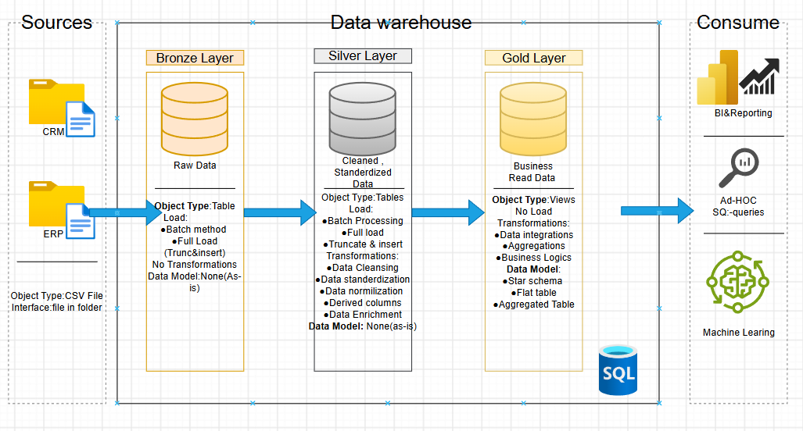
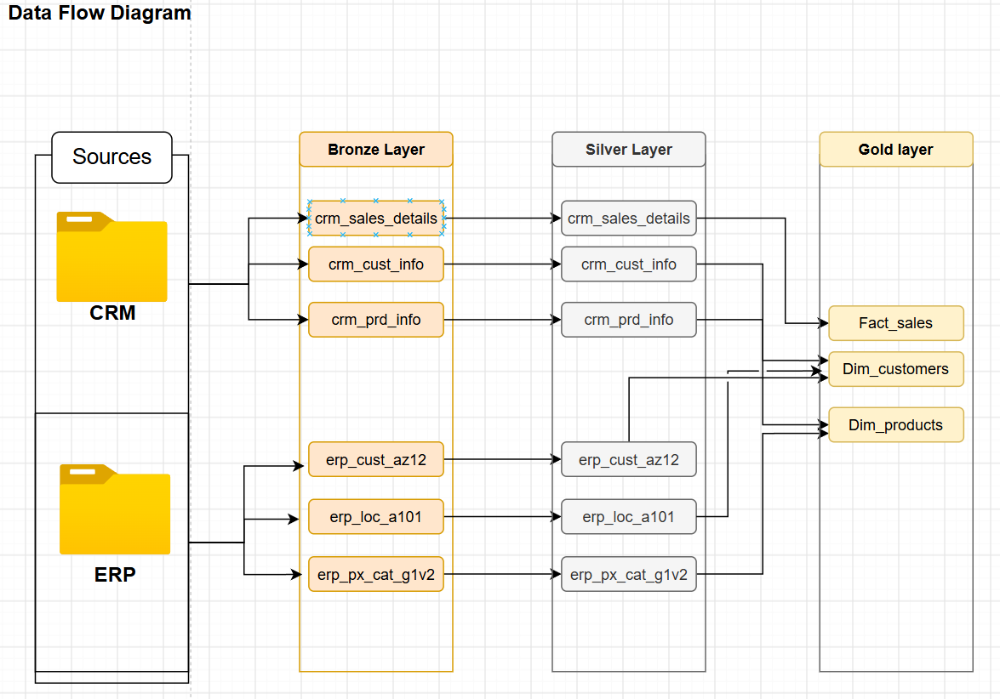
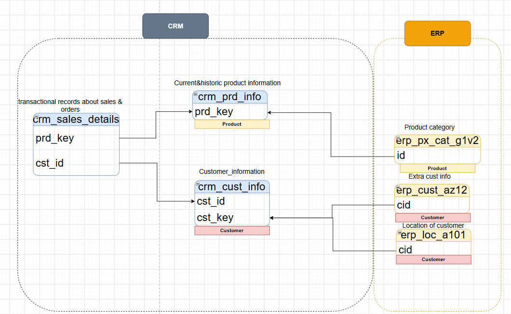

youssef-wahby-Data-Mart---ELT---Data-Warehouse

My first end-to-end SQL Data Warehouse &amp; ELT project(Data mart), featuring a Medallion Architecture (Bronze, Silver, Gold), full-load data ingestion using TRUNCATE and INSERT, data transformation, and architecture documentation using draw.io.

## 📌 Project Overview

This project implements an end-to-end SQL Data Warehouse and ELT pipeline using Microsoft SQL Server. It integrates CRM and ERP source data, processes it through a Medallion Architecture consisting of Bronze, Silver, and Gold layers, and transforms raw data into structured, analytics-ready datasets.

The pipeline demonstrates SQL-based data ingestion, data cleansing, transformation, and dimensional modeling, supported by architecture documentation created with draw.io.

**Project Goal:** Build a structured and maintainable data warehouse that transforms raw source data into reliable, analytics-ready information.

## 🏗️ Architecture

## 🔄 Data Pipeline Flow

1. **Data Sources:** CRM and ERP datasets provide the source data.
2. **Bronze Layer:** Raw source data is loaded into the warehouse using a full-load ingestion strategy.
3. **Silver Layer:** Data is cleaned, standardized, and prepared for further processing.
4. **Gold Layer:** Business-ready datasets are organized into analytical models and data marts.
5. **Documentation:** The data architecture is documented using draw.io.

**Loading Strategy:** The pipeline uses `TRUNCATE` and full-load ingestion where implemented, replacing existing table contents before reloading the source data.

## 🛠️ Tech Stack

* **Microsoft SQL Server** — Database platform used to implement the data warehouse and execute SQL-based ingestion and transformation.
* **SQL** — Used for data loading, cleansing, transformation, and analytical modeling.
* **Medallion Architecture** — Organizes data into Bronze, Silver, and Gold layers.
* **draw.io** — Used to document and visualize the data warehouse architecture.
-sql
-sql-server
-data-warehouse
-elt
-data-engineering
-medallion-architecture
-data-modeling

  

